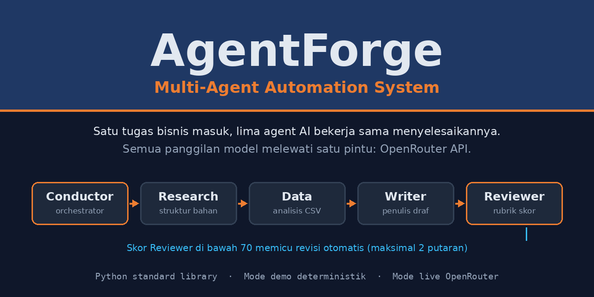
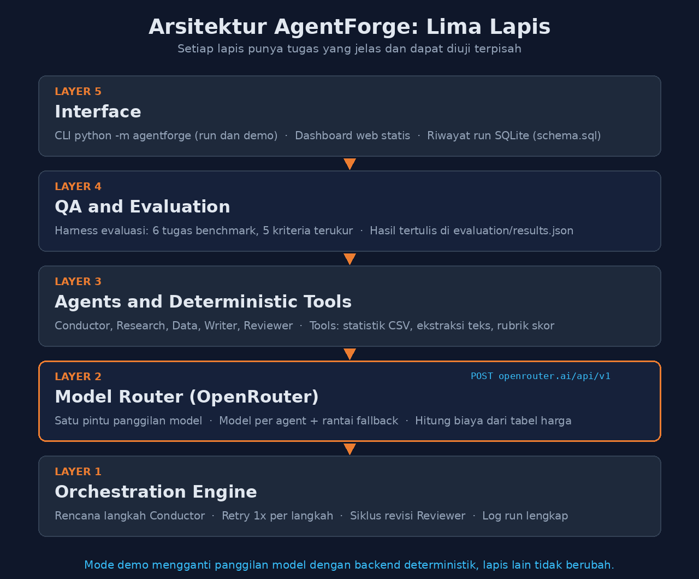
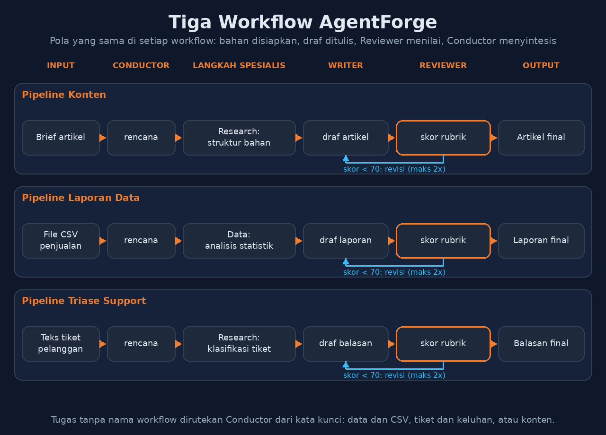
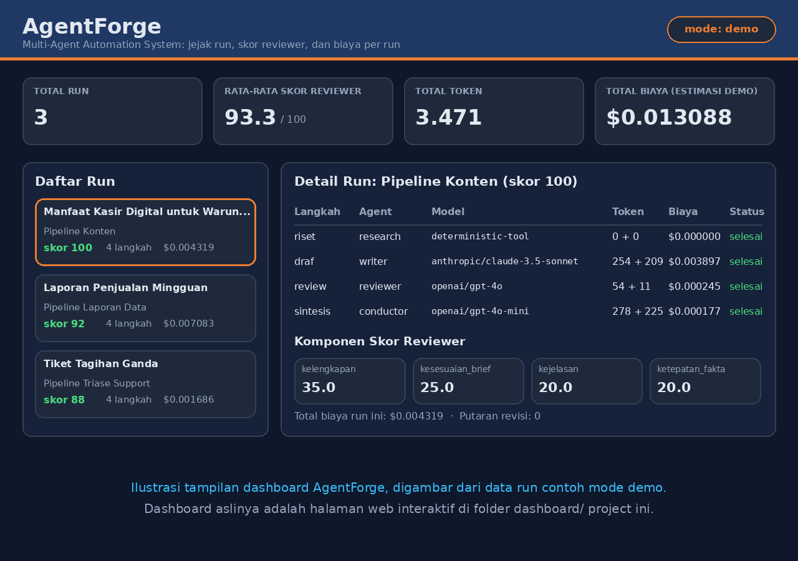

# AgentForge: Multi-Agent Automation System



**AgentForge** adalah sistem otomasi multi-agent yang mengubah satu
tugas bisnis menjadi hasil akhir yang terperiksa. Sebuah tugas masuk,
Conductor menyusun rencana langkahnya, agent spesialis mengerjakan
bagiannya masing-masing, Reviewer menilai kualitas draf dengan rubrik
skor, dan hasil final disusun kembali lengkap dengan catatan biaya per
langkah. Semua panggilan model melewati satu pintu, yaitu OpenRouter
API, sehingga setiap agent dapat memakai model yang berbeda sesuai
kebutuhan dan biayanya.

AgentForge tidak mewajibkan API key untuk dicoba. Tanpa key, sistem
berjalan dalam **mode demo deterministik**: seluruh alur orkestrasi,
rubrik penilaian, test suite, dan harness evaluasi berjalan penuh
tanpa biaya dan tanpa panggilan jaringan. Dengan key, sistem beralih
ke **mode live** dan memanggil model sungguhan lewat OpenRouter.

> Teknologi: Python 3.10+ (hanya standard library, tanpa dependensi
> pihak ketiga) · OpenRouter API · SQLite · Dashboard HTML/CSS/JS ·
> Docker

## Table of Contents

- [What It Does](#what-it-does)
- [Architecture](#architecture)
- [The Agents](#the-agents)
- [Model Router and OpenRouter](#model-router-and-openrouter)
- [Workflows](#workflows)
- [Quickstart](#quickstart)
- [Demo Run Example](#demo-run-example)
- [Evaluation](#evaluation)
- [Testing](#testing)
- [Dashboard](#dashboard)
- [Road to SaaS](#road-to-saas)
- [Project Structure](#project-structure)
- [Limitations](#limitations)
- [License](#license)

## What It Does

**Masalah.** Pekerjaan pengetahuan yang berulang, seperti menulis
konten dari brief, menyusun laporan dari file CSV, dan membalas tiket
pelanggan, biasanya dikerjakan manual satu per satu. Memakai satu
model bahasa untuk semuanya juga boros: tugas ringan membayar harga
model kuat, dan tidak ada pemeriksa kualitas sebelum hasil dipakai.

**Solusi.** AgentForge membagi pekerjaan itu ke lima agent dengan
peran yang jelas, diorkestrasi oleh engine deterministik:

1. Conductor menyusun rencana langkah dari template workflow.
2. Agent spesialis menyiapkan bahan dan menulis draf.
3. Reviewer menilai draf dengan rubrik skor 0 sampai 100. Draf di
   bawah ambang 70 otomatis direvisi, maksimal 2 putaran.
4. Conductor menyintesis hasil final, dan setiap langkah tercatat:
   agent, model, token, biaya, status, dan durasi.

**Untuk siapa.** Pengembang dan tim kecil yang ingin fondasi sistem
multi-agent yang dapat diaudit biayanya, pemilik usaha yang ingin
mengotomatiskan konten, laporan data, dan triase support, serta siapa
pun yang menilai project AI dari hasil evaluasi yang terukur, bukan
sekadar klaim. Rencana pengembangan menjadi produk SaaS berbayar ada
di [ROADMAP-SAAS.md](ROADMAP-SAAS.md).

## Architecture



### Layer 1: Orchestration Engine

`agentforge/orchestrator.py` menjalankan rencana Conductor langkah
demi langkah sesuai dependensi. Setiap langkah dibungkus retry
sederhana (satu kali pengulangan) dan dicatat lengkap: id langkah,
agent, aksi, model, mode, token prompt dan completion, biaya,
status, jumlah percobaan, dan durasi. Setelah langkah review, engine
menjalankan siklus revisi: bila skor Reviewer di bawah ambang
(bawaan 70, dapat dikonfigurasi), Writer memperbaiki draf
berdasarkan catatan Reviewer dan draf dinilai ulang, maksimal 2
putaran.

### Layer 2: Model Router (OpenRouter)

`agentforge/router.py` adalah satu-satunya pintu panggilan model.
Rincian cara kerja, tabel harga, dan cara mengganti model ada di
bagian [Model Router and OpenRouter](#model-router-and-openrouter).

### Layer 3: Agents and Deterministic Tools

Setiap agent adalah modul terpisah di `agentforge/agents/` dengan
peran dan prompt sistemnya sendiri. Agent tidak mengarang angka:
angka dan struktur berasal dari tools deterministik di
`agentforge/tools/`:

- `csv_tools.py`: statistik deskriptif kolom numerik, agregasi per
  kelompok, dan tren sederhana dari file CSV. Parser angkanya
  mengenali format polos, desimal koma, dan format Indonesia
  campuran seperti 2.500,75.
- `text_tools.py`: ekstraksi poin kunci, fakta (kalimat berisi
  angka), kata kunci, dan klasifikasi tiket support berbasis aturan
  kata kunci (kategori dan prioritas).
- `rubric_tools.py`: rubrik Reviewer. Skor tersusun dari kelengkapan
  elemen wajib (35), kesesuaian brief (25), kejelasan (20), dan
  ketepatan fakta (20). Angka yang muncul di draf tetapi tidak ada
  di bahan sumber menurunkan komponen ketepatan fakta.

### Layer 4: QA and Evaluation

`evaluation/run_evaluation.py` menjalankan 6 tugas benchmark
(`evaluation/benchmark.json`, dua tugas per workflow) dalam mode
demo dan menilai setiap run dengan lima kriteria terukur: rencana
valid, semua langkah selesai, skor Reviewer mencapai ambang, elemen
wajib lengkap, dan output final substantif. Hasilnya ditulis ke
`evaluation/results.json`. Rincian ada di bagian
[Evaluation](#evaluation).

### Layer 5: Interface

- CLI: `python -m agentforge run ...` dan `python -m agentforge demo`.
  Kesalahan penggunaan yang umum, seperti file input tidak ditemukan
  atau workflow laporan data tanpa file CSV, ditampilkan sebagai
  pesan singkat dengan kode keluar 2, bukan traceback.
- Dashboard web statis di `dashboard/` (HTML, CSS, JavaScript) yang
  membaca `dashboard/data/runs.json`: daftar run, jejak langkah per
  agent, komponen skor Reviewer, dan rincian biaya per run.
- Riwayat run persisten di SQLite memakai `schema.sql` (tabel `runs`
  dan `run_steps`), ditulis oleh `agentforge/store.py`, perintah CLI
  dengan opsi `--db`, atau skrip `scripts/seed_demo_runs.py`.

## The Agents

| Agent | Peran | Model bawaan | Fallback | Cara kerja langkahnya |
| --- | --- | --- | --- | --- |
| Conductor | Menyusun rencana langkah, menentukan urutan, menyintesis hasil akhir | openai/gpt-4o-mini | google/gemini-flash-1.5, lalu meta-llama/llama-3.3-70b-instruct | Rencana memakai template workflow deterministik dan perutean kata kunci; model dipanggil pada langkah sintesis |
| Research | Menstrukturkan teks menjadi poin kunci, fakta, dan kata kunci; mengklasifikasikan tiket support | google/gemini-flash-1.5 | openai/gpt-4o-mini, lalu meta-llama/llama-3.3-70b-instruct | Langkah struktur dan klasifikasi berjalan sebagai tools deterministik, tanpa panggilan model |
| Data | Menganalisis CSV secara deterministik lalu menarasikan temuan | openai/gpt-4o-mini | deepseek/deepseek-chat, lalu google/gemini-flash-1.5 | Statistik dihitung tools; model dipanggil untuk menarasikan fakta |
| Writer | Menulis draf artikel, laporan, atau balasan; memperbaiki draf berdasarkan catatan Reviewer | anthropic/claude-3.5-sonnet | openai/gpt-4o, lalu openai/gpt-4o-mini | Model dipanggil untuk draf; revisi bersifat deterministik di kedua mode |
| Reviewer | Menilai draf dengan rubrik skor 0 sampai 100 dan memicu revisi bila di bawah ambang | openai/gpt-4o | anthropic/claude-3.5-sonnet, lalu openai/gpt-4o-mini | Skor resmi selalu dari rubrik deterministik; model hanya merangkai catatan naratif |

Dua hal yang perlu dipahami dari tabel ini:

- Perencanaan Conductor **bukan** hasil panggilan model. Rencana
  berasal dari template tiga workflow yang terdaftar di
  `agentforge/agents/conductor.py`, dan tugas tanpa nama workflow
  dirutekan dari kata kunci (data dan CSV ke laporan data, tiket dan
  keluhan ke triase support, sisanya ke konten). Sifat deterministik
  ini disengaja agar rencana selalu dapat divalidasi dan diuji.
- Langkah Research pada workflow saat ini murni tools, sehingga di
  log run langkahnya tercatat dengan model `deterministic-tool` dan
  0 token. Entri model Research di konfigurasi tetap dipertahankan
  sebagai identitas agent pada rantai router dan menjadi jalur
  panggilan model Research bila langkahnya dikembangkan.

## Model Router and OpenRouter

Cara kerja perutean di `agentforge/router.py`:

- **Mode live** mengirim POST ke
  `https://openrouter.ai/api/v1/chat/completions` memakai urllib
  dari standard library, dengan header standar OpenRouter
  (Authorization, HTTP-Referer, X-Title). Payload untuk model
  dirangkai sebagai pesan user JSON agar model menerima konteks
  terstruktur yang sama seperti mode demo.
- Setiap agent punya model utama plus rantai fallback. Bila model
  utama gagal (error HTTP, timeout, atau respons kosong), router
  mencoba model berikutnya secara berurutan dan mencatat semua model
  yang dicoba di log run. Bila seluruh rantai gagal, router
  mengangkat error yang jelas dan run berhenti.
- Biaya dihitung dari tabel harga per 1 juta token di
  `config/models.json`. Di mode live, token berasal dari respons API
  yang sebenarnya (usage), sedangkan tabel harga tetap dipakai untuk
  mengubah token menjadi estimasi dolar.
- **Mode demo** tidak melakukan panggilan jaringan sama sekali. Teks
  disusun oleh `agentforge/demo_backend.py` dari aturan dan template
  berdasarkan hasil tools terstruktur, sehingga hasilnya
  deterministik: input yang sama selalu menghasilkan run yang sama.
  Token tetap diestimasi dari panjang teks (sekitar 4 karakter per
  token) agar log biaya tetap bermakna untuk demo dan evaluasi.
- Model yang tidak ada di tabel harga dihitung berbiaya nol agar
  perhitungan tidak meledak diam-diam. Bila mengganti model, tambahkan
  harganya ke tabel agar biaya tetap tercatat.

Tabel harga yang dipakai saat ini (USD per 1 juta token, indikatif
mengikuti harga publik OpenRouter dan perlu diperbarui berkala):

| Model | Prompt | Completion |
| --- | --- | --- |
| openai/gpt-4o-mini | 0,15 | 0,60 |
| openai/gpt-4o | 2,50 | 10,00 |
| anthropic/claude-3.5-sonnet | 3,00 | 15,00 |
| google/gemini-flash-1.5 | 0,075 | 0,30 |
| meta-llama/llama-3.3-70b-instruct | 0,35 | 0,40 |
| deepseek/deepseek-chat | 0,14 | 0,28 |

Mengganti model ada dua cara:

1. Edit `config/models.json` (kolom `model` dan `fallbacks` per
   agent, serta `review_threshold` dan `max_revisions` global).
2. Timpa satu model lewat environment variable tanpa mengubah file:

```bash
export AGENTFORGE_MODEL_WRITER="openai/gpt-4o"
```

Pola variabelnya `AGENTFORGE_MODEL_<AGENT>` dengan nama agent huruf
besar: CONDUCTOR, RESEARCH, DATA, WRITER, REVIEWER.

Mengaktifkan mode live:

1. Buat API key di openrouter.ai.
2. Ekspor key-nya (lihat `.env.example` untuk daftar variabel):

```bash
export OPENROUTER_API_KEY="key-anda"
python -m agentforge demo
```

Selama variabel ini terisi, router memanggil model sungguhan
mengikuti `config/models.json`. Kosongkan kembali untuk kembali ke
mode demo.

## Workflows



### 1. Pipeline Konten (`konten`)

Brief masuk, Research menstrukturkan bahan menjadi poin kunci dan
kata kunci, Writer menyusun draf artikel, Reviewer menilai, Conductor
menyintesis hasil final.

- Contoh input: file `data/samples/brief_konten.txt`, brief artikel
  blog tentang manfaat kasir digital untuk pemilik warung makan,
  lengkap dengan angka wajib (120 transaksi per hari, hemat sekitar
  90 menit pencatatan per minggu).
- Contoh output: artikel final untuk pemilik warung makan kecil,
  skor Reviewer 100, tanpa putaran revisi (run contoh di bagian
  [Demo Run Example](#demo-run-example)).

### 2. Pipeline Laporan Data (`laporan_data`)

File CSV dianalisis Data Agent lewat tools statistik, Writer
menarasikan laporan dari fakta tools, Reviewer menilai, final.

- Contoh input: file `data/samples/penjualan_mingguan.csv`, 18 baris
  penjualan 6 minggu untuk 3 produk warung makan.
- Fakta yang dibaca tools, antara lain: dataset berisi 18 baris dan
  4 kolom; tren kolom pendapatan naik 12,4 persen (rata-rata paruh
  kedua dibanding paruh pertama); penyumbang terbesar adalah Soto
  Kecil dengan total pendapatan 13.795.000.
- Contoh output: laporan naratif berisi angka temuan dan kesimpulan
  tren, skor Reviewer 92.

### 3. Pipeline Triase Support (`triase_support`)

Teks tiket diklasifikasikan Research (kategori dan prioritas), Writer
menyusun draf balasan, Reviewer menilai, final.

- Contoh input: file `data/samples/tiket_support.txt`, keluhan
  tagihan terpotong dua kali sebesar Rp149.000.
- Hasil klasifikasi deterministik: kategori **tagihan**, prioritas
  **tinggi** (kata penanda antara lain tagihan, kembalian, ganda,
  dan segera).
- Contoh output: draf balasan sopan berisi pengakuan masalah dan
  janji kabar lanjutan paling lambat satu hari kerja, skor Reviewer
  88.

Tugas bebas tanpa nama workflow dirutekan Conductor secara
deterministik berdasarkan kata kunci, contoh:

```bash
python -m agentforge run --title "Tiket" \
  --input "Ada tiket keluhan pelanggan soal tagihan dobel"
# dirutekan ke triase_support
```

## Quickstart

Tidak ada dependensi pihak ketiga. Cukup Python 3.10 atau lebih
baru. Jalankan semua perintah dari root project. Bila sistem Anda
hanya menyediakan perintah `python3` (umum di Linux), ganti `python`
dengan `python3` pada semua perintah di bawah.

```bash
# Jalankan tiga workflow contoh sekaligus (mode demo)
python -m agentforge demo

# Pipeline konten dari file brief contoh
python -m agentforge run --workflow konten \
  --title "Manfaat Kasir Digital" \
  --input-file data/samples/brief_konten.txt

# Pipeline laporan data dari CSV contoh
# (perintah persis ini mereproduksi run contoh berskor 92 di bawah)
python -m agentforge run --workflow laporan_data \
  --title "Laporan Penjualan Mingguan" \
  --csv data/samples/penjualan_mingguan.csv \
  --input "Susun laporan data penjualan mingguan per produk dan bacakan tren pendapatannya."

# Pipeline triase support dari file tiket contoh
python -m agentforge run --workflow triase_support \
  --title "Tiket Tagihan Ganda" \
  --input-file data/samples/tiket_support.txt

# Simpan hasil run lengkap ke JSON dan riwayat ke SQLite
python -m agentforge demo --out outputs/sample_runs.json --db db/agentforge.db

# Isi ulang data demo untuk outputs, dashboard, dan SQLite sekaligus
python scripts/seed_demo_runs.py

# Test suite, seed data demo, dan evaluasi dalam satu perintah
./run.sh

# Dashboard: sajikan dari root project, lalu buka alamatnya
python -m http.server 8000
# http://localhost:8000/dashboard/

# Docker (mode demo)
docker build -t agentforge .
docker run --rm agentforge
```

Catatan reproduksi: skor Reviewer dipengaruhi isi brief atau input
yang diberikan, karena rubrik menilai kesesuaian draf terhadap brief.
Mengubah kalimat input pada contoh laporan data di atas akan mengubah
skornya, dan itu perilaku yang diharapkan, bukan bug.

## Demo Run Example

Satu run Pipeline Konten dari `python -m agentforge demo` (angka
persis dari file `outputs/sample_runs.json` yang dihasilkan skrip
seed):

| Langkah | Agent | Model | Token (prompt + completion) | Biaya (USD) |
| --- | --- | --- | --- | --- |
| riset | research | deterministic-tool | 0 + 0 | 0,000000 |
| draf | writer | anthropic/claude-3.5-sonnet | 254 + 209 | 0,003897 |
| review | reviewer | openai/gpt-4o | 54 + 11 | 0,000245 |
| sintesis | conductor | openai/gpt-4o-mini | 278 + 225 | 0,000177 |
| **Total** | | | **1.031** | **0,004319** |

Skor Reviewer run ini **100 dari 100** (komponen: kelengkapan 35,0;
kesesuaian brief 25,0; kejelasan 20,0; ketepatan fakta 20,0), tanpa
putaran revisi. Langkah riset tercatat sebagai `deterministic-tool`
karena langkah struktur Research memang berjalan sebagai tools, bukan
panggilan model.

Dua run contoh lainnya dari perintah yang sama:

| Workflow | Skor Reviewer | Total Token | Biaya (USD) | Catatan |
| --- | --- | --- | --- | --- |
| Pipeline Laporan Data | 92 | 1.987 | 0,007083 | Tren pendapatan naik 12,4 persen terbaca dari CSV contoh |
| Pipeline Triase Support | 88 | 453 | 0,001686 | Tiket terklasifikasi tagihan, prioritas tinggi |

Total tiga run contoh: 3.471 token dan USD 0,013088. Biaya pada mode
demo adalah simulasi dari tabel harga indikatif, bukan tagihan
sungguhan.

## Evaluation

Hasil `python evaluation/run_evaluation.py` dalam mode demo
(`evaluation/results.json`). Harness menilai lima kriteria per tugas:
rencana valid, semua langkah selesai, skor Reviewer mencapai ambang,
elemen wajib lengkap (dinilai ulang dari draf final memakai rubrik
yang sama), dan output final substantif (lebih dari 150 karakter).

| Tugas | Workflow | Skor Reviewer | Revisi | Token | Biaya (USD) | Semua Kriteria |
| --- | --- | --- | --- | --- | --- | --- |
| konten-01 | konten | 100 | 0 | 1.031 | 0,004319 | Lulus |
| konten-02 | konten | 95 | 0 | 774 | 0,003116 | Lulus |
| data-01 | laporan_data | 92 | 0 | 1.987 | 0,007083 | Lulus |
| data-02 | laporan_data | 90 | 0 | 1.775 | 0,006277 | Lulus |
| support-01 | triase_support | 88 | 0 | 453 | 0,001686 | Lulus |
| support-02 | triase_support | 95 | 0 | 506 | 0,001930 | Lulus |

Ringkasan per workflow:

| Workflow | Tugas | Lulus Semua Kriteria | Rata-rata Skor Reviewer |
| --- | --- | --- | --- |
| konten | 2 | 2 | 97,5 |
| laporan_data | 2 | 2 | 91,0 |
| triase_support | 2 | 2 | 91,5 |
| **Total** | **6** | **6** | |

Kelima kriteria tercapai pada 6 dari 6 tugas. Perlu dicatat bahwa
benchmark ini menilai konsistensi alur dan rubrik dalam mode demo
deterministik; benchmark ini bukan pengukuran kualitas model bahasa,
karena mode demo memang tidak memanggil model.

## Testing

```bash
python -m unittest discover -s tests -t . -v
```

Hasil saat ini: **34 tes, semuanya lulus**. Cakupannya:

- Conductor: perutean kata kunci, validitas rencana, deteksi
  dependensi rusak dan ID langkah duplikat, penolakan workflow tak
  dikenal.
- Router: penyelesaian mode demo, hitungan biaya dengan nilai yang
  diketahui persis, biaya nol untuk model tak dikenal, rantai
  fallback (model utama gagal pindah ke fallback), dan error saat
  semua model gagal.
- Reviewer dan rubrik: draf baik lulus, draf lemah gagal dengan
  catatan, angka asing menurunkan skor, dan siklus revisi menaikkan
  draf lemah sampai lulus.
- Tiga workflow end-to-end dalam mode demo.
- Tools: analisis CSV contoh (jumlah baris, tren, agregasi), parsing
  angka format Indonesia, klasifikasi tiket tagihan, ekstraksi fakta
  dan kata kunci.
- CLI: kesalahan penggunaan umum menghasilkan pesan ramah dan kode
  keluar 2, bukan traceback.
- Store: penulisan dan pembacaan riwayat run SQLite.

## Dashboard



Gambar di atas adalah **ilustrasi tampilan** yang digambar dari data
run contoh mode demo yang sebenarnya (skor 100, 92, dan 88; total
3.471 token; total biaya USD 0,013088), bukan tangkapan layar.
Dashboard aslinya adalah halaman web interaktif di folder
`dashboard/`: kartu ringkasan (total run, rata-rata skor Reviewer,
total token, total biaya), daftar run yang dapat diklik, tabel jejak
langkah per agent, komponen skor Reviewer, dan output final tiap run.

Cara membukanya: isi datanya dengan
`python scripts/seed_demo_runs.py`, sajikan root project dengan
`python -m http.server 8000`, lalu buka
`http://localhost:8000/dashboard/`. Dashboard membaca file
`dashboard/data/runs.json`, jadi membuka berkas HTML langsung dari
disk tanpa server tidak akan memuat datanya.

## Road to SaaS

Repo ini adalah Fase 1 (MVP) dari rencana produk. Ringkasnya:

- **Fase 1, MVP (repo ini)**: engine orkestrasi, lima agent, router
  OpenRouter, tiga workflow, CLI, dashboard, SQLite, tes, evaluasi.
- **Fase 2, Multi-Tenant**: workspace terisolasi, akun dan peran,
  kuota per workspace, API REST dan webhook, migrasi ke PostgreSQL.
- **Fase 3, Penagihan dan Langganan**: langganan per agent aktif,
  meteran per run di atas kuota, masa coba, integrasi payment
  gateway, dan penanganan pembayaran gagal.
- **Fase 4, Marketplace Agent dan Workflow**: katalog paket workflow
  pihak ketiga dengan manifest terstandar, sandbox eksekusi, dan
  bagi hasil penerbit.
- **Fase 5, Enterprise**: SSO dan SCIM, audit log yang tidak dapat
  diubah, residensi data, dedicated tenant, dan SLA tertulis.

Jabaran lengkap tiap fase (ruang lingkup, kebutuhan teknis, metrik
keberhasilan) dan skema harga indikatif ada di
[ROADMAP-SAAS.md](ROADMAP-SAAS.md).

## Project Structure

```
agentforge-multi-agent-system/
  agentforge/                Paket utama
    agents/                  Conductor, Research, Data, Writer, Reviewer
    tools/                   csv_tools, text_tools, rubric_tools
    orchestrator.py          Layer 1: Orchestration Engine
    router.py                Layer 2: Model Router OpenRouter
    demo_backend.py          Backend simulasi deterministik mode demo
    config.py                Pemuatan config dan environment
    store.py                 Penyimpanan riwayat run SQLite
    cli.py                   Layer 5: antarmuka baris perintah
  config/models.json         Model per agent, fallback, tabel harga
  dashboard/                 Layer 5: dashboard web statis + data/runs.json
  data/samples/              Brief, tiket, dan CSV contoh
  db/agentforge.db           SQLite riwayat run hasil seed demo
  docs/img/                  Banner, diagram arsitektur, diagram workflow, pratinjau dashboard
  evaluation/                Benchmark dan harness evaluasi (Layer 4)
  outputs/sample_runs.json   Hasil tiga run contoh
  scripts/seed_demo_runs.py  Pengisi data demo (outputs, dashboard, SQLite)
  tests/                     Test suite (unittest, standard library)
  schema.sql                 Skema tabel runs dan run_steps
  ROADMAP-SAAS.md            Roadmap pengembangan menuju produk SaaS
  Dockerfile                 Image demo (python:3.12-slim)
  .dockerignore              Menjaga .env dan artefak lokal keluar dari image
  run.sh                     Tes + seed + evaluasi dalam satu perintah
  requirements.txt           Kosong secara sengaja: tanpa dependensi pihak ketiga
  .env.example               Contoh variabel environment (tanpa nilai rahasia)
  LICENSE                    Lisensi MIT
```

## Limitations

- Mode demo adalah simulasi deterministik berbasis aturan dan
  template. Teksnya berguna untuk menguji alur, rubrik, dan biaya,
  tetapi bukan hasil penalaran model bahasa.
- Jalur mode live terimplementasi penuh (rantai fallback dan
  perhitungan biaya teruji dengan transport pengganti), tetapi
  selama pembangunan tidak diuji dengan API key OpenRouter
  sungguhan. Perilaku model tertentu di mode live dapat berbeda dari
  simulasi demo, misalnya format jawaban model yang tidak mengikuti
  konteks terstruktur.
- Kualitas mode live bergantung penuh pada model yang dipilih untuk
  tiap agent dan pada kualitas brief yang diberikan pengguna.
- Perencanaan tugas memakai template workflow deterministik dan
  perutean kata kunci, bukan perencanaan bebas oleh model. Workflow
  baru berarti menambah template di Conductor.
- Langkah Research (struktur bahan dan klasifikasi tiket) berjalan
  sebagai tools deterministik. Klasifikasi tiket berbasis kata kunci
  dapat salah pada tiket dengan bahasa campuran atau eufemisme.
- Rubrik Reviewer bersifat heuristik berbasis kata penanda dan kata
  kunci. Rubrik ini konsisten dan dapat diuji, tetapi tidak memahami
  makna sedalam penilai manusia. Skornya adalah skor konsistensi
  terhadap brief, bukan jaminan kualitas tulisan.
- Tabel harga model bersifat indikatif dan dapat berubah mengikuti
  harga OpenRouter. Biaya dolar di log adalah estimasi, bukan bukti
  tagihan. Model yang tidak tercantum di tabel dihitung berbiaya nol.
- Data Agent membaca CSV sederhana dengan baris header dan pemisah
  koma. Angka berdesimal koma wajib dikutip di dalam file CSV agar
  tidak terbaca sebagai pemisah kolom. Format CSV yang tidak rapi
  (delimiter campuran, kolom kosong) belum ditangani khusus.
- Riwayat SQLite dan dashboard ditujukan untuk satu pengguna.
  Kebutuhan multi-pengguna, autentikasi, dan penagihan adalah ruang
  lingkup Fase 2 dan 3 pada ROADMAP-SAAS.md.

## License

Dirilis di bawah Lisensi MIT. Lihat berkas [LICENSE](LICENSE) untuk
teks lengkapnya.
